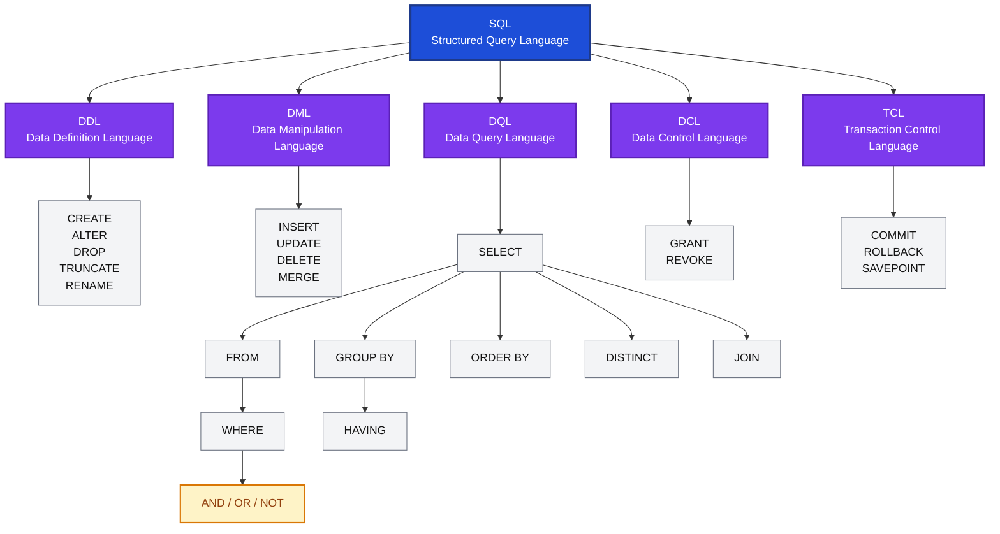
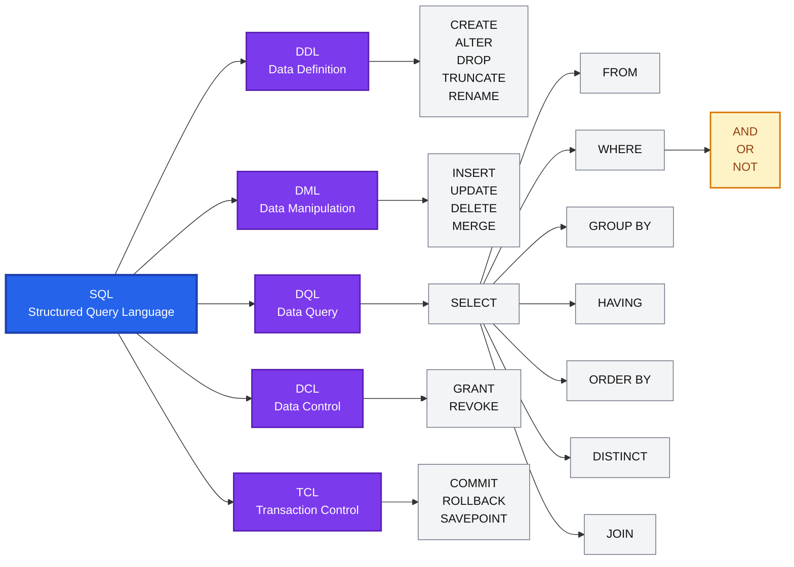
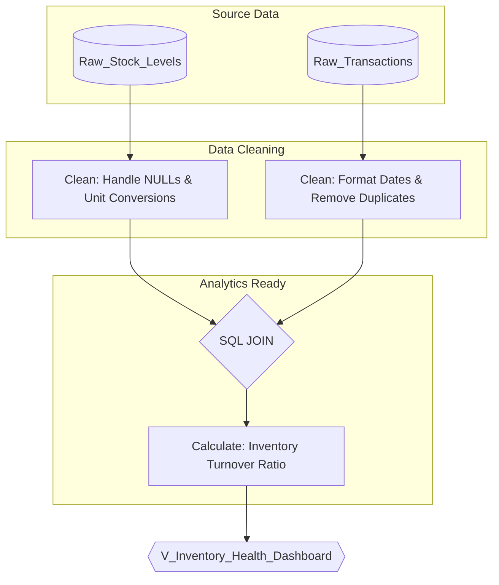

# Flowcharts
# Example - SQL

## Code
```bash
flowchart TB
    SQL["SQL<br/>Structured Query Language"]
SQL --> DDL["DDL<br/>Data Definition Language"]
SQL --> DML["DML<br/>Data Manipulation Language"]
SQL --> DQL["DQL<br/>Data Query Language"]
SQL --> DCL["DCL<br/>Data Control Language"]
SQL --> TCL["TCL<br/>Transaction Control Language"]

DDL --> DDL_C["CREATE<br/>ALTER<br/>DROP<br/>TRUNCATE<br/>RENAME"]

DML --> DML_C["INSERT<br/>UPDATE<br/>DELETE<br/>MERGE"]

DQL --> SELECT["SELECT"]

SELECT --> FROM["FROM"]
FROM --> WHERE["WHERE"]
WHERE --> LOGIC["AND / OR / NOT"]

SELECT --> GROUP["GROUP BY"]
GROUP --> HAVING["HAVING"]

SELECT --> ORDER["ORDER BY"]
SELECT --> DISTINCT["DISTINCT"]
SELECT --> JOIN["JOIN"]

DCL --> DCL_C["GRANT<br/>REVOKE"]

TCL --> TCL_C["COMMIT<br/>ROLLBACK<br/>SAVEPOINT"]

classDef sql fill:#1d4ed8,color:white,stroke:#1e3a8a,stroke-width:3px
classDef category fill:#7c3aed,color:white,stroke:#5b21b6,stroke-width:2px
classDef command fill:#f3f4f6,color:#111,stroke:#6b7280
classDef logic fill:#fef3c7,color:#92400e,stroke:#d97706,stroke-width:2px

class SQL sql
class DDL,DML,DQL,DCL,TCL category
class DDL_C,DML_C,SELECT,FROM,WHERE,GROUP,HAVING,ORDER,DISTINCT,JOIN,DCL_C,TCL_C command
class LOGIC logic

```

## Flowchart



# Example - SQL 2



# Example - Database


