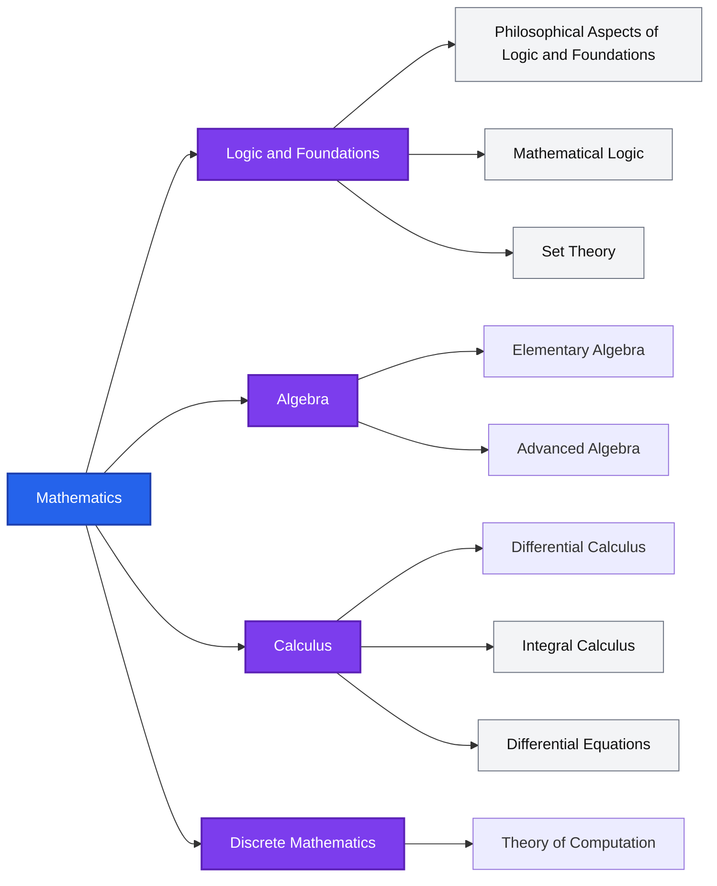

# Classification of Mathematics

## Example 1

### Code

```bash
flowchart LR

Math["Mathematics"]
Math --> LogicAndFoundations["Logic and Foundations"]
Math --> Algebra["Algebra"]
Math --> Calculus["Calculus"]
Math -->DiscreteMath["Discrete Mathematics"]

%% Logic and Foundations
LogicAndFoundations-->PhilosophicalAspects["Philosophical Aspects of Logic and Foundations"]
LogicAndFoundations-->MathematicalLogic["Mathematical Logic"]
LogicAndFoundations-->SetTheory["Set Theory"]
%% Algebra
Algebra-->ElementaryAlgebra["Elementary Algebra"]
Algebra-->AdvancedAlgebra["Advanced Algebra"]
%% Calculus
Calculus-->DifferentialCalculus["Differential Calculus"]
Calculus-->IntegralCalculus["Integral Calculus"]
Calculus-->DifferentialEquations["Differential Equations"]
%% Discrete Mathematics
DiscreteMath-->TheoryComputation["Theory of Computation"]

%% STYLES --------------------------------------------
classDef math fill:#2563eb,color:#fff,stroke:#1e40af,stroke-width:2px
classDef main-category fill:#7c3ded,color:#fff,stroke:#5b21b6,stroke-width:2px
classDef category fill:#f3f4f6,color:#111,stroke:#6b7280
classDef subcategory fill:#fef3c7,color:#92400e,stroke:#d97706,stroke-width:2px

class Math math
%% Math Branches ---------
class LogicAndFoundations,Algebra,Calculus,DiscreteMath main-category

%% Categories ----------------

%% Logic and Foundations 
class PhilosophicalAspects,MathematicalLogic,SetTheory category

%% Calculus
class IntegralCalculus,DifferentialEquations category

%% Subcategories --------

class Logic1 subcategory
```

### Flowchart



