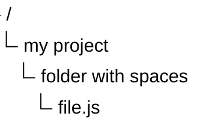

# Tree View Diagram

## Introduction 

A TreeView diagram is used to represent hierarchical data in the form of a directory-like structure, with file/folder icons, connector lines, and optional annotations.

## Syntax 

The structure of the tree depends only on indentation. Labels can be **bare** (unquoted) or **quoted** (for names containing spaces).

- Directories are indicated by a trailing `/` on the label — they render in bold text.
- Icons are hidden by default — enable the built-in file/folder icons with the `showIcons` config option, or set one per node with `icon()`.
- Quoted labels (`"my file"`) support spaces in names.


```bash
treeView-beta
    my-project/
        src/
            index.js
        package.json
        README.md
```


### 

Quoted labels (backward compatible):


```bash
treeView-beta
    "my project"
        "folder with spaces"
            "file.js"
```





## Box-Drawing Input 

Icons are hidden by default. Set the `showIcons` config option to `true` to show the built-in icons — `file` for files and `folder` for directories:

```bash
---
config:
  treeView:
    showIcons: true
---
treeView-beta
    algebra/
        README.md
	calculus/
		README.md
    README.md
```


`

`


# References

* https://mermaid.ai/open-source/syntax/treeView.html